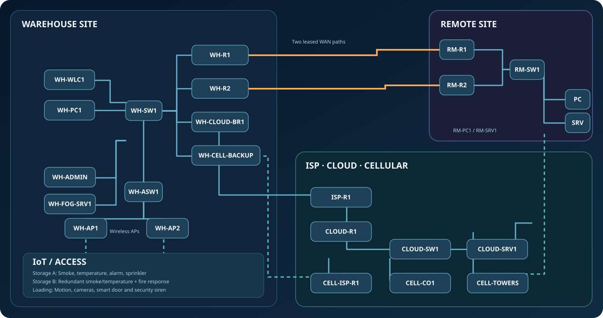

# Remote Warehouse Monitoring System

**Cisco Packet Tracer | IoT monitoring, fog computing and resilient enterprise networking**

This project models a geographically separated warehouse and remote monitoring station. It brings together environmental and intrusion sensing, local emergency automation, segmented wireless access, resilient intersite routing and a simulated cellular connection for cloud access during primary-link failure.

## Architecture

- **Warehouse:** 3560 multilayer core switch, 2960 access switch, wireless LAN controller, two lightweight access points, office devices and a local fog IoT registration server.
- **IoT monitoring:** Smoke, temperature, motion, camera, smart-door, siren and sprinkler devices, organised into Storage A, Storage B and Loading/Intrusion groups.
- **Remote monitoring:** Redundant routers, an access switch, a monitoring PC and a remote IoT server.
- **WAN:** Two independent provider-managed *leased-circuit representations* (serial in Packet Tracer), with OSPF routing and a backup path.
- **Cloud:** An ISP/cloud routing path with BGP peering and a reachable cloud server.
- **Cellular:** Simulated 3G/4G tower, central office and cellular router providing an alternative path to the cloud.

## Technologies implemented

| Component | Implementation |
| --- | --- |
| Segmentation | VLAN 10 office, VLAN 20 IoT, VLAN 30 employee WLAN, VLAN 50 fog, VLAN 99 management |
| Wireless | WLC with two lightweight APs; separated employee and IoT WLANs |
| Routing | OSPF for routed intersite paths, EIGRP on the warehouse/cloud side, eBGP on the ISP edge |
| Resilience | Dual WAN paths, OSPF reconvergence, HSRP gateway redundancy and floating cellular backup route |
| Traffic management | IOS QoS classes for fog-related and routine IoT traffic |
| Security | VLAN isolation and named ACL restrictions on management access |
| Local automation | Smoke/heat threshold conditions on the local fog registration server |

## IoT alert workflow

Storage B uses two smoke sensors and two temperature sensors. Smoke or abnormal heat triggers a warning siren. For a simulated confirmed fire, the sprinkler rules require **smoke plus a high-temperature reading** from either eligible sensor. A single unavailable smoke sensor does not necessarily prevent a second sensor from triggering the rule. This is a learning simulation, **not a certified fire-safety system**.

## Validation carried out in Packet Tracer

- WAN routers formed OSPF adjacencies, and routing changed to the secondary serial path during primary-link failure.
- The remote monitoring site maintained its gateway through HSRP takeover.
- EIGRP adjacency and eBGP peering were observed.
- The warehouse PC reached the remote server, local fog server and cloud server during normal operation.
- When the primary cloud link failed, the warehouse core selected the floating static route through the cellular router; traceroute and NAT translations showed cellular cloud access.
- Smoke-only, heat-only and smoke-plus-heat conditions produced different warning/sprinkler responses.
- With both leased WAN links disconnected, the local fog dashboard remained accessible inside the warehouse, and the simulated fire response operated.

## Practical limitations

This is a **Packet Tracer simulation**, not a physical telecom installation. The serial circuits stand in for provider-managed leased WAN services rather than literal long-distance copper links. The cellular infrastructure uses a simplified **3G/4G model**, not actual 5G NR, URLLC or network slicing. Likewise, SD-WAN orchestration and NFV are design considerations, not functions demonstrated by the simulation. Failover tests primarily demonstrate link-triggered rerouting, not comprehensive application-health monitoring.

## Project files

The source simulation was developed and tested in Cisco Packet Tracer. This case study intentionally excludes the assessed university report and personal student information. The latest local working **.pkt** project should be uploaded separately once its final copy has been confirmed.

*Project: 2026 · Remote Warehouse Monitoring System*
